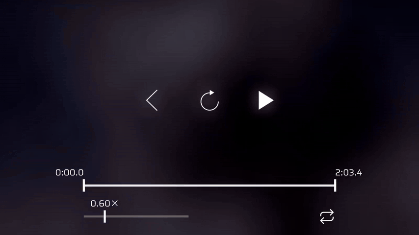
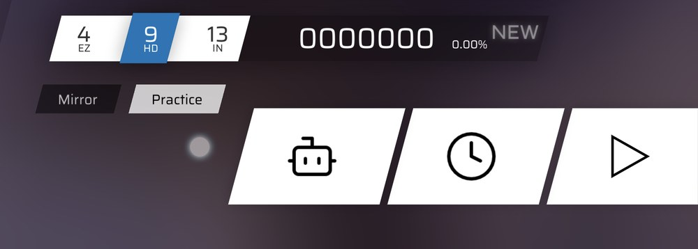
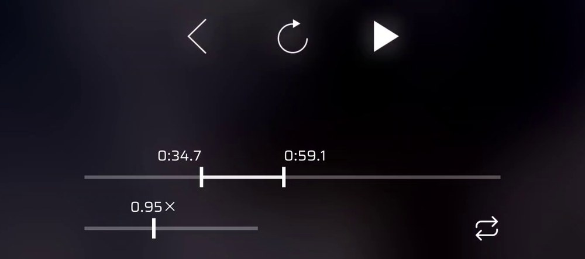
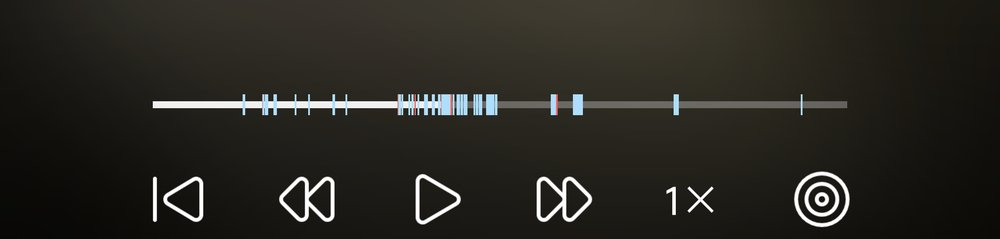
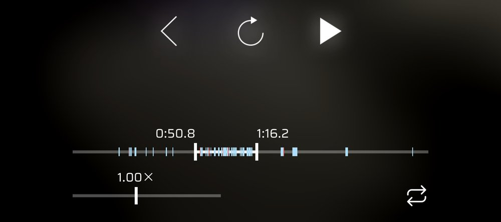

# Practice

A mod for [Phigros++](https://github.com/ggmolly/PhigrosPlusPlus) that adds a Practice switch next to the song list's Mirror one. With it on, a song opens paused on a timeline: drag the two ends of the section to practise, pick a speed from 0.25× to 2× and whether the section loops, then resume. The section plays from its start, right where it was trimmed, with the score and the counts back at zero. The golden mark under the timeline is where resuming plays from: drag it anywhere in the section, and a section paused midway goes on from there. Tapping a time types it, in seconds. The song never ends, so nothing of it is saved: no record, no replay, nothing sent to phigros.tools. A button in the replay player starts the same practice on the mistakes of the replay being watched.

## Install

Open the **Mods** tab of the game's settings and pick Practice in the catalog, or open [this link](phigrospp://install/ggmolly/phigrospp-practice) on the device.

## Settings

| Setting | |
|---|---|
| Practice mode | The same switch as the one on the song list |
| Practice speed | From 0.25× to 2×, the music's pitch follows it |
| Loop the section | Off, the song pauses at the section's end |
| Lead-in | Seconds of music played before the section starts, none by default |

The speed and the loop are also on the timeline, which shows whenever the song is paused. Dragging an end of the section shows the chart there.

## From a replay

While a replay is watched, its player has one more button, a target. It starts the song again as a practice of the mistakes nearest to where the replay was: the goods, bads and misses less than two seconds apart make the section, with two seconds around them, and a replay without any mistake gives the four seconds around that moment. The practice lasts until the song list, whatever the Practice switch says.

The timeline shows the replay's goods in blue and its bads and misses in red, so the section's ends can be moved with them in sight.

## How it works

The game makes every note when a level starts and destroys each one once it's judged. To start a section, the mod asks Phigros++ to put the song at its start (`phigrospp.jump`), which destroys the notes left, has the game make the ones up to the section's end again and moves the music, then it sets the score back to zero. The game's time comes from a clock that ignores the music's pitch, so at other speeds the mod gives it where the music really is.

The level is told it can't end and that it doesn't count (`phigrospp.counts`), so it isn't recorded and the game never reaches the result screen, where it saves a play. Challenge mode and replays play as usual.

It needs a Phigros++ newer than 0.3.0-beta.3, for `phigrospp.replay.button`, `marks` and `takeover`. On iOS it needs JIT, its hooks aren't written into the IPA.
